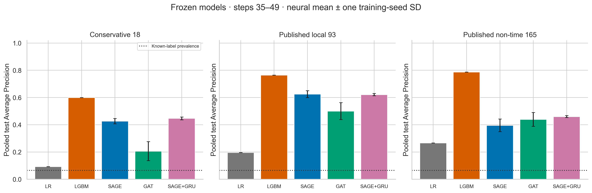
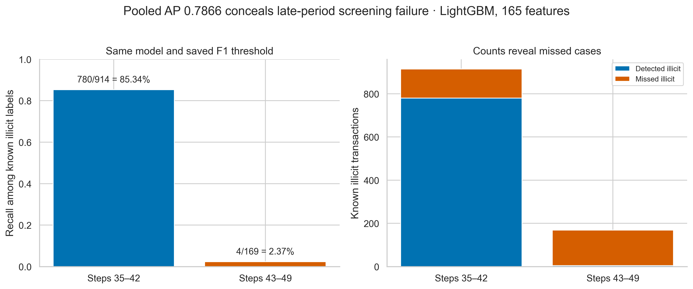
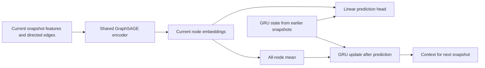
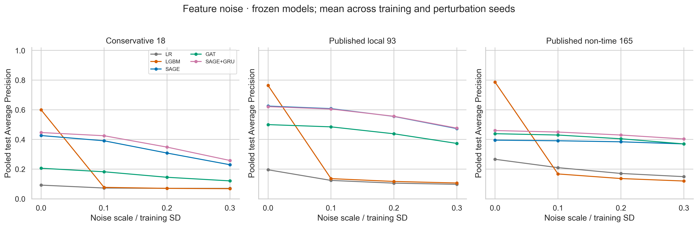

# Temporal Graph Neural Networks for Risk Detection Under Distribution Shift

**Pattanapong Jetjaratpong** · Independent Researcher · [ORCID 0009-0002-3218-5719](https://orcid.org/0009-0002-3218-5719) · [GitHub repository](https://github.com/ArsunPatt/temporal-gnn-risk-detection)

A notebook-first research project on the **original Elliptic Bitcoin dataset**, comparing tabular, graph and historical-context learning under chronological evaluation. Built with pandas, scikit-learn, LightGBM, PyTorch and PyTorch Geometric for Apple Silicon. The published v1.0.0 release includes five completed notebooks covering Stages 1–5, 60 PNG/SVG figure pairs and an 11-page manuscript.

**Main result:** LightGBM leads pooled test AP, but its 165-feature model detects only **4 of 169 known illicit transactions in steps 43–49 (2.37% recall)** at the frozen F1 threshold. Its pooled AP of **0.7866** therefore conceals a severe late-period operating-policy failure. No test-label threshold optimization was performed. The late-window diagnostic is post-hoc and descriptive.

[Final results notebook](notebooks/05_research_results.ipynb) · [Paper](reports/research_paper.md) · [PDF](reports/research_paper.pdf) · [Reproducibility](reports/reproducibility.md) · [Quality report](reports/final_quality_report.md) · [Release notes](RELEASE_NOTES.md)

[GitHub repository](https://github.com/ArsunPatt/temporal-gnn-risk-detection) · [v1.0.0 release](https://github.com/ArsunPatt/temporal-gnn-risk-detection/releases/tag/v1.0.0) · [Zenodo archive and DOI](https://doi.org/10.5281/zenodo.24323048)

## Research question and motivation

Does graph learning improve future-period illicit detection over strong tabular models using the **same features and evaluation nodes**? Risk-screening decisions require ranking quality, threshold reliability and temporal stability.

Weber et al. (2019) reported that Random Forest outperformed GCN and Skip-GCN on illicit-class F1 and that performance deteriorated after time step 43. [Original Elliptic study, Table 1 and Figure 2](https://arxiv.org/abs/1908.02591)

Maganti (2026) likewise reports a Random Forest advantage under its inductive training protocol and studies the effects of training-time exposure to test-period adjacency and of shuffling edges. [Related Elliptic preprint](https://arxiv.org/abs/2604.19514)

This project contributes matched comparisons across the 18-, 93-, and 165-feature sets, evaluation at operating thresholds fixed before testing, a descriptive quantification of the late-period detection failure, and controlled robustness tests with feature and edge perturbations.

This is an independent historical empirical benchmark and has not been peer-reviewed. Known labels are selected, unknown transactions are not negatives, and **none of the 18/93/165 feature groups is certified leakage-free**. Results do not establish causal graph benefits, real-time deployability or universal architecture superiority.

## Main experimental results

Frozen test steps 35–49 contain **16,670 known labels, including 1,083 illicit**. Neural entries are raw AP mean ± one training-seed SD across 42/43/44. Seed SD is not a statistical confidence interval. Tabular models retain their selected seed-42 configurations.

| Matched features | Logistic Regression | LightGBM | GraphSAGE | GAT | Historical GRU |
|---|---:|---:|---:|---:|---:|
| Conservative 18 | 0.0922 | 0.5993 | 0.4263 ± 0.0194 | 0.2059 ± 0.0699 | 0.4466 ± 0.0101 |
| Published local 93 | 0.1956 | 0.7639 | 0.6246 ± 0.0254 | 0.5000 ± 0.0618 | 0.6211 ± 0.0082 |
| Published non-time 165 | 0.2664 | 0.7866 | 0.3953 ± 0.0463 | 0.4387 ± 0.0507 | 0.4599 ± 0.0069 |






Pooled AP measures ranking across periods; frozen-threshold recall measures detections at an earlier-selected operating point. Neither substitutes for the other. LightGBM's early-window recall is 780/914 (85.34%), versus 4/169 late. Full results include ROC-AUC, actual FPR, precision/recall/F1, top-25 labeled-review precision, Brier and calibration error. Review metrics represent the known-label subset, not the full operational population.

## Methods and architecture

- Logistic Regression and LightGBM: ordinary/class-weighted development searches, training-only preprocessing, saved calibration and thresholds.
- GraphSAGE and GAT: two-layer directed snapshot models, unknown-node context with supervised masks, inductive inference on later snapshots.
- GraphSAGE + Historical GRU Context: mean all-node snapshot embedding, strictly earlier GRU state, prediction before state update.
- Matched inputs: conservative transaction 18; published local 93; published non-time 165. The larger configurations already include engineered relational information, so all-feature LightGBM is not a graph-free information baseline.



The temporal head adds a shared snapshot logit offset. It cannot directly rerank nodes within that snapshot at fixed weights; separately trained encoder differences do not isolate historical value. No persistent transaction histories or artificial cross-time edges are created.

## Key findings and limitations

- LightGBM has the highest matched pooled AP on **unperturbed benchmark inputs** under the saved training budgets.
- **Temporal reliability:** performance deteriorates late across families. Covariate shifts and changing observed-label prevalence do not alone establish concept drift or an external cause.
- **Robustness:** neural models better tolerate the specified Gaussian noise; LightGBM remains strongest under 30% mean masking. Edge removal sometimes helps GAT. These stresses are not equivalent in severity or validated financial corruption scenarios; published aggregates stay unchanged under edge edits.
- **Uncertainty:** all nine paired LightGBM-minus-GNN descriptive intervals are positive, but only 15 test snapshots, length-three circular blocks and 12 unadjusted comparisons limit inference. Seed variability and temporal sampling uncertainty are separate.
- **Source validity:** the 2026 feature-transparency audit documents leakage concerns. Chronological splits and training-only scaling cannot repair source contamination. Model-side chronology limits the released nodes and edges to the snapshot cutoff. Published successor aggregates can still incorporate information from transactions after snapshot end. The 18-feature sensitivity excludes documented address histories and neighborhood aggregates. This reduces exposure to known leakage mechanisms, while point-in-time safety remains uncertified.
- **Optimization:** 19/44 earlier fits reached the update cap, including nine selected main models. Limited budgets and unequal capacities prevent universal conclusions.



## Dataset and chronology

Obtain the **original** [Elliptic Data Set](https://www.kaggle.com/datasets/ellipticco/elliptic-data-set), not Elliptic++. It contains 203,769 transactions, 234,355 directed edges, 49 snapshots and 166 published features including time. Labels are 4,545 illicit, 42,019 licit and 157,205 unknown (77.15%).

| Use | Steps |
|---|---|
| Training | 1–29 |
| Hyperparameters and stopping | 30–31 |
| Calibration and thresholds | 32–33 |
| Later validation assessment | 34 |
| Frozen final test | 35–49 |

At snapshot end, models use eligible features and edges only. Stage 1 disclosed descriptive full-period label counts. The final test has now been evaluated and cannot be reused as a fresh tuning set.

## Repository structure

```text
notebooks/01_data_exploration.ipynb
notebooks/02_ml_baselines.ipynb
notebooks/03_graph_temporal_models.ipynb
notebooks/04_robustness_analysis.ipynb
notebooks/05_research_results.ipynb
src/                 # small readable data/model/evaluation/cache helpers
scripts/             # public smoke check, cache audit, summary/PDF/release tools
tests/               # synthetic/public checks; explicit private integration guards
results/             # compact aggregate tables, configurations and provenance
reports/figures/     # publication PNG and SVG; reused directly in notebooks
reports/             # editable paper/PDF, protocols, audit and quality reports
data/                # local raw/processed inputs; ignored
models/              # local fitted artifacts; ignored
requirements.txt
requirements-lock.txt
LICENSE
THIRD_PARTY_NOTICES.md
PROJECT_STATUS.md
```

## Installation and execution

Use the v1.0.0 tag or the archived ZIP when verifying the published snapshot. For the verified ZIP, extract it and start at the environment setup. Run physical archive verification before creating any local environment or cache inside the extracted directory. Use checkout mode in a Git repository.

```bash
git clone --branch v1.0.0 https://github.com/ArsunPatt/temporal-gnn-risk-detection.git
cd temporal-gnn-risk-detection
python3.11 -m venv .venv
source .venv/bin/activate
python -m pip install -r requirements-lock.txt
python -m pip check
python scripts/smoke_test.py
python -B -m pytest -q -rs -p no:cacheprovider
python -m jupyter lab
```

Tested research stack: native arm64 Python 3.11.1, PyTorch 2.8.0, PyG 2.7.0, LightGBM 4.6.0 and scikit-learn 1.7.2. The pinned wheels require compatible macOS (tested 15.3; NumPy/SciPy wheels require 14+). LightGBM needs native OpenMP; use `brew install libomp` if its documented import error occurs. Model operations were verified individually and as full architectures: GraphSAGE/GAT use MPS here; historical GRU uses CPU. The existing one-thread OpenMP test-harness fix is preserved.

Notebook 05 is the frozen publication-results viewer. It reads the included aggregate tables and displays all 19 saved figures without writing release files. All five notebooks retain editable code and representative outputs. Notebook 05 presents 19 distinct narrative figures, reusing 13 and adding six summaries; the full release includes 60 PNG/SVG figure pairs, including four manuscript-specific pairs. The labeled transaction-subgraph illustration is omitted from the public package.

For a fresh full reproduction, download and place these files in `data/raw/`:

```text
elliptic_txs_features.csv   # headerless: ID + 166 features
elliptic_txs_classes.csv
elliptic_txs_edgelist.csv
```

Use a separate reproduction checkout. Earlier notebooks write to repository-relative paths and may overwrite published tables or figures if run in the original working directory. Run **01 → 02 → 03 → 04** with FULL_RUN, then use the parameterized summary helper. Notebook 05 retains the frozen publication assertions and graphics. On an existing completed checkout, reuse its saved models/caches instead. New training artifacts will not necessarily match published byte hashes: notebook 04 requires a fresh reproduction output directory and explicit inference opt-in, without overwriting the published frozen protocol. See the [step-by-step guide](reports/reproducibility.md) for exact path settings and recovery commands. QUICK_RUN is exploratory and never substitutes official evidence.

## Provenance and reproducibility boundary

The original [frozen Stage 4 protocol](results/stage4/frozen_protocol.json) is unchanged. The dated [release manifest](results/stage5/release_manifest.json) covers final code, notebooks, configurations, environment and relevant artifact hashes. It **cannot retroactively establish the original complete code freeze**.

Cache validation checks protocol/prediction hashes, complete model populations, all 720 robustness results and 1,080 edge-audit rows. Per-scenario completion records prevent incomplete results from being silently reused. Explicit recovery rebuilds tables from verified complete caches; it never invents missing predictions.

The independent Stage 4 audit verified numerical and code consistency but **did not reproduce inference from private checkpoints and predictions**. Public tests explicitly skip unavailable private inputs; a skip is not an inference-reproduction success. A fresh environment/public-package check and local cache checks are reported in the [quality report](reports/final_quality_report.md). On November 15, 2026, a local CPU audit replayed all 33 frozen models from verified original Elliptic CSVs, checkpoints, and fitted preprocessing artifacts. The maximum absolute pooled AP difference across the raw and Platt-calibrated variants was 0.00000221, and every frozen F1 decision matched. The replay used the existing machine and retained private artifacts. External independent reproduction remains unverified.

## Citation, data rights and references

Cite the software using [CITATION.cff](CITATION.cff). Cite the manuscript as Jetjaratpong, P. (2026). *Do Graph Neural Networks Improve Illicit Bitcoin Transaction Detection Under Temporal Distribution Shift? Evidence from the Elliptic Dataset* (v1.0.0, research manuscript). [Manuscript PDF](reports/research_paper.pdf).

Original software is [MIT licensed](LICENSE). The original manuscript and eligible original figures are licensed under [CC BY 4.0](https://creativecommons.org/licenses/by/4.0/). See the [scope and attribution notice](reports/manuscript_rights.md). Elliptic data retain separate **CC BY-NC-ND 4.0** terms; raw/derived transaction datasets, checkpoints, prediction records, credentials and environments are excluded from Git and the publication ZIP. Third-party software and source papers retain their own terms; see [notices](THIRD_PARTY_NOTICES.md).

- Weber et al. (2019), [original Elliptic study](https://arxiv.org/abs/1908.02591).
- Hamilton et al. (2017), [GraphSAGE](https://arxiv.org/abs/1706.02216); Veličković et al. (2018), [GAT](https://arxiv.org/abs/1710.10903).
- Šafář et al. (2026), [feature opacity and leakage](https://doi.org/10.1016/j.fsidi.2026.302124); [public semantics](https://github.com/nesfit/DeanonymizedEllipticBitcoinDataset).
- Complete references and methods: [research paper](reports/research_paper.md), [BibTeX](reports/references.bib).
